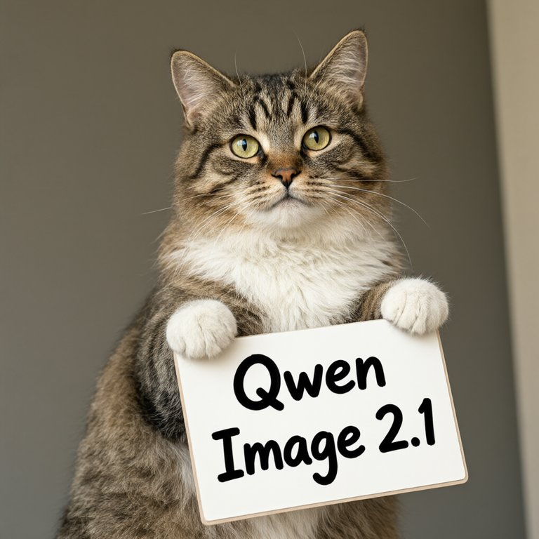

# Qwen Image Chat

**Qwen-Image-2.1（7B）を、ChatGPT のようなチャット画面から使うためのローカル画像生成パイプラインです。**
文章で頼めば画像を生成し、画像を添付すればその画像を指示どおりに編集します。
「もっと明るく」「背景を夜にして」と続ければ、直前に作った画像を編集します。
PC のブラウザ、同じ Wi-Fi のスマホ、Telegram のどこからでも使えます。

すべて手元の PC で動きます。生成のたびにクラウドへデータを送ることはありません。

```
┌──────────────┐   ┌───────────────────────────────┐   ┌──────────────────────────┐
│ ブラウザ      │   │ app/ (FastAPI)                 │   │ sd-server                │
│ スマホ        ├──►│  router    : 生成/編集の判定      ├──►│ (stable-diffusion.cpp)    │
│ Telegram Bot │   │  enhancer  : 公式PEで指示を書き直し │   │ Qwen-Image-2.1 Turbo/Base │
└──────────────┘   │  会話履歴・画像の保存              │   │ + Qwen3-VL 8B エンコーダ  │
                   └───────────────┬───────────────┘   └──────────────────────────┘
                                   └──► Ollama: Qwen-Image-2.1-PE-T2I / PE-I2I（任意）
```

## 例

| 指示 | 結果 |
|---|---|
| ①「ふわふわの白い子猫が桜の木の下で昼寝している水彩画」<br>② 続けて「空に花火を上げて」（画像の添付なし。直前の画像を自動で編集） |   |
| 猫の写真を添付して「この猫に魔女の帽子をかぶせて、看板の文字を『ハッピーハロウィン』に」 |   |
| 「レトロな喫茶店の外観、看板に『純喫茶 七夕』」（Base モデル） |  |

## 特徴

- **チャットUI**: 会話履歴、画像の添付（ボタン／貼り付け／ドラッグ＆ドロップ）、生成途中のプレビュー、再生成、保存、「この画像を編集」ボタン
- **生成と編集の自動判定**: 画像を添付すれば編集、添付なしで直前の画像に言及すれば連続編集、それ以外は新規生成。参照画像は最大10枚
- **公式プロンプト強化**: Qwen 公式の PE-T2I／PE-I2I が、短い指示を詳しい英語プロンプトに書き直します。編集時は画像の中身を読んだうえで、「変える部分」と「保つ部分」を明示します
- **比率の自動判定**: 「横長」「縦長」「16:9」「スマホ壁紙」などの言葉で比率が決まります
- **スマホ対応**: 同じ LAN の端末から `http://<PCのIP>:7860` で開けます
- **Telegram Bot**: 外出先からも、文章を送れば生成、写真を送れば編集できます
- **AMD GPU 対応**: Vulkan 版 stable-diffusion.cpp を使うので、CUDA は不要です（NVIDIA・Intel でも動作）

## 動作環境と速度の目安

開発・動作確認は、Windows 11、Radeon RX 9070 XT（16GB）、RAM 32GB、Vulkan の環境で行いました。

| 処理 | 解像度 | 時間（実測） |
|---|---|---|
| 新規生成（Turbo・8ステップ） | 1024×1024 | 約35〜40秒 |
| 編集（Turbo・参照画像1枚） | 1024×1024 | 約55〜60秒 |
| 新規生成（Turbo） | 2048×2048 | 約3分15秒 |
| 新規生成（Base・30ステップ） | 1024×1024 | 約2分50秒 |
| プロンプト強化（公式PE・GPU） | — | 約10〜15秒追加 |

VRAM 16GB、RAM 32GB を推奨します。重みは RAM に置き、必要な分だけ VRAM に載せます（`--offload-to-cpu`）。テキストエンコーダは CPU で動かし、空いた VRAM を編集の高速化（prefix KV cache）に回しています。

## セットアップ

1. （任意・推奨）[Ollama](https://ollama.com/) をインストールします。入れるとプロンプト強化が使えるようになります。
2. `setup.bat` をダブルクリックします。次のものを自動でダウンロードします。
   - stable-diffusion.cpp（Vulkan 版）
   - Qwen-Image-2.1 Turbo（int8）、Qwen3-VL-8B エンコーダ（Q4_K_M）、VAE：約14GB
   - 公式プロンプト強化モデル PE-T2I／PE-I2I（Q4_K_M）：約12GB（Ollama がある場合のみ）

   オプション:
   ```powershell
   powershell -ExecutionPolicy Bypass -File setup.ps1 -WithBase        # 高品質 Base モデルも取得（+7.3GB）
   powershell -ExecutionPolicy Bypass -File setup.ps1 -Backend cuda12  # NVIDIA で CUDA 版を使う
   ```
3. `start.bat` をダブルクリックすると、ブラウザで `http://localhost:7860` が開きます。

止めるときは `start.bat` のウィンドウで Ctrl+C を押します。画像エンジン（sd-server）はアプリが自動で起動・監視しており、落ちても自動で再起動します。終了時も一緒に止まりますが、残ってしまった場合は `stop.bat` で止められます。

## スマホから使う（同じ Wi-Fi）

1. `start.bat` の画面に表示される `http://192.168.x.x:7860` をスマホで開きます。
2. つながらない場合は、`allow-lan.bat` を一度だけ実行します（管理者の確認が出ます）。Windows ファイアウォールに、**同じサブネットからだけ** ポート 7860 を許可する規則を追加します。

> ⚠️ Web UI にはログイン機能がありません。自宅など信頼できるネットワークだけで使ってください。外出先からは、次の Telegram Bot を使う方法が安全です。

## Telegram から使う

1. Telegram で **@BotFather** を開き、`/newbot` を送ります。表示名とユーザー名（末尾は `bot`）を決めると、トークン（`123456789:AA...`）が届きます。
2. `local.json` の `"telegram_token"` にトークンを貼り付け、`start.bat` を起動し直します。
3. 作った Bot に `/start` を送ると「あなたのユーザーID: 123456789」と返ってきます。その数字を `"telegram_allowed_users": [123456789]` に追加して、もう一度起動し直します。

使い方:
- 文章を送ると生成します。
- 写真を送ると、キャプションの指示どおりに編集します。複数枚をまとめて送ると、参照画像として扱います。
- 生成後に「もっと明るく」などと送ると、直前の画像を編集します。
- 画像の下のボタン: **↻ 別案** / **🔍 高精細で**（約4MP） / **📄 原寸**（圧縮なしのPNG） / **📝 プロンプト**
- コマンド: `/new`（新しい会話）、`/quality fast|standard|high`、`/model turbo|base`、`/enhance on|off`、`/settings`

Bot はロングポーリングで動くため、ルーターのポート開放は不要です。Telegram の会話は Web UI の履歴にも表示されます。

## PC の起動時に自動で動かす

`install-autostart.bat` を一度実行すると、Windows にログインした約30秒後に、アプリ（Web UI・Telegram Bot・画像エンジン）がウィンドウなしで起動します。タスク スケジューラに `QwenImageChat` という名前で登録されます。管理者権限は不要です。

- 出力は `data\logs\app.log` に記録されます。
- 止めるときは `stop.bat`、自動起動をやめるときは `uninstall-autostart.bat` を実行します。
- プロンプト強化に使う Ollama は、インストール時にスタートアップへ登録されるので、そのままで一緒に起動します。

## 設定（local.json）

`local.json` は初回の `setup.bat` 実行時に `local.example.json` から作られます。Git の管理対象外です。

| キー | 既定値 | 説明 |
|---|---|---|
| `model_root` | `models/qwen-image-2.1` | モデルの置き場所（既存のフォルダを指定してもよい） |
| `sdcpp_dir` | `bin/sdcpp` | stable-diffusion.cpp の実行ファイルがあるフォルダ |
| `app_port` / `sd_port` | `7860` / `1234` | チャットアプリ / 画像エンジンのポート |
| `ollama_url` | `http://127.0.0.1:11434` | プロンプト強化に使う Ollama |
| `telegram_token` | `""` | Telegram Bot のトークン |
| `telegram_allowed_users` | `[]` | Bot の利用を許可する Telegram ユーザーID |
| `telegram_notify_users` | 許可リストの先頭のID | アプリ起動時に「🟢 起動しました」を送る相手（`[]` で通知しない） |

画質プリセット（UI と Telegram で切り替え）:

| プリセット | 画素数 | 1:1 の場合 |
|---|---|---|
| 高速 `fast` | 約1MP | 1024×1024 |
| 標準 `standard` | 約2MP | 1440×1440 |
| 高精細 `high` | 約4MP | 2048×2048（Qwen-Image-2.1 のネイティブ解像度） |

## ファイル構成

```
app/
  server.py        FastAPI 本体（API・ジョブ管理・sd-server 連携）
  router.py        生成か編集かの判定と、比率の検出
  enhancer.py      公式 PE（Ollama）によるプロンプト書き換え
  telegram_bot.py  Telegram Bot
  sdserver.py      sd-server の起動・監視・モデル切り替え（Turbo/Base）
  config.py        パス・解像度・サンプリング設定
  static/          チャット UI（HTML/CSS/JS）
setup.ps1 / start.ps1 / allow-lan.ps1   セットアップ・起動・LAN許可
install-autostart.ps1 / uninstall-autostart.ps1   ログイン時の自動起動の登録・解除
stop.bat           アプリと画像エンジンの停止
```

## ライセンスとクレジット

- このリポジトリのコードは MIT License です。
- 以下のモデルとソフトウェアは、それぞれのライセンスに従います。モデルの重みはこのリポジトリに含まれず、setup で各配布元から取得します。
  - [Qwen-Image-2.1](https://huggingface.co/Qwen/Qwen-Image-2.1)、[Qwen-Image-2.1-PE-T2I](https://huggingface.co/Qwen/Qwen-Image-2.1-PE-T2I) / [PE-I2I](https://huggingface.co/Qwen/Qwen-Image-2.1-PE-I2I)：Qwen Research License
  - [Qwen3-VL-8B-Instruct-GGUF](https://huggingface.co/Qwen/Qwen3-VL-8B-Instruct-GGUF)
  - [Comfy-Org/Qwen-Image-2.1](https://huggingface.co/Comfy-Org/Qwen-Image-2.1)（int8 量子化重み）、[prithivMLmods](https://huggingface.co/prithivMLmods)（PE の GGUF）
  - [stable-diffusion.cpp](https://github.com/leejet/stable-diffusion.cpp)（MIT）
